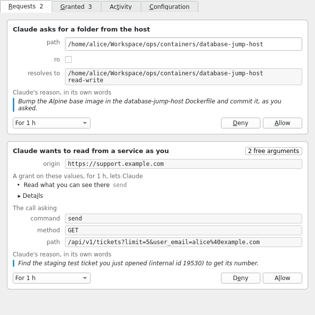
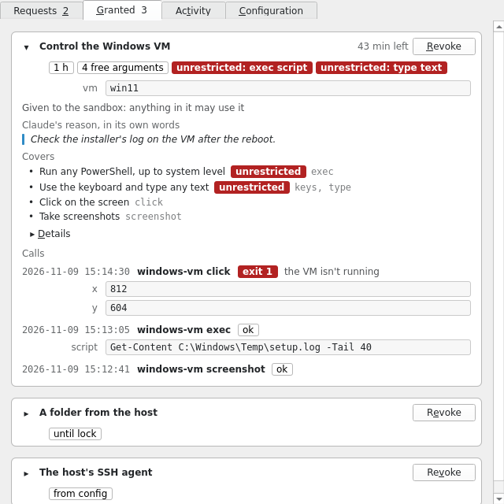

# agent-sandbox

An agent with a shell runs as you. It can read `~/.ssh`, every repo you have
checked out, and the browser profile, and it can reach whatever your machine
can: the VPN mesh, the auth proxy on `127.0.0.1`, the cluster API behind them.
One prompt injection in a README it was asked to summarise is enough to use
all of that.

agent-sandbox runs an agent's desktop app in a bubblewrap sandbox on NixOS,
built with [nixpak](https://github.com/nixpak/nixpak). The apps are Claude
Desktop (with its Code tab) and [Paseo](https://github.com/getpaseo/paseo)
(a desktop app whose daemon runs agent CLIs such as Claude Code and Codex); the
sandbox itself, its core, knows no app, and an app is a small module on it. It sees only
the paths you bind into it. It gets its own network namespace, joined to the
host by a netkit pair whose eBPF programs let it out only through the
physical uplink with the default route (Ethernet or Wi-Fi, IPv4 and IPv6, NATed by
[einat](https://github.com/EHfive/einat-ebpf)), so it reaches the internet
and the LAN of that uplink but none of the services on the host, the subnets of
its other NICs, VPN routes, container bridges, link-local addresses (a cloud
metadata service) or other sandboxes, whatever the host firewall says. The LAN sees it at the address of the host
(einat NATs it there), so a LAN service that trusts the host address trusts
the sandbox too. Nothing reaches it but replies, and your own processes on the host
on a port you grant it (Permissions). It has its
own single-user Nix store, so `nix shell` and `nix build` work without the
daemon of the host. The
privileged parts are a small helper, `netns-netkit`, with `cap_net_admin`
and `cap_bpf` to create the pair and attach its programs, and two system
services: einat and `sandbox-uplink`, which keeps the programs around einat
on the uplinks.

The sandbox comes with a doc for the Claude running inside it,
`/etc/claude/environment.md`, which says what it can see and where its limits
are. Your own `CLAUDE.md` imports it.

How it fits together, namespace by namespace: the diagram at the top of
[`nix/home/sandbox/default.nix`](nix/home/sandbox/default.nix), the core, which
also says what an app gives it; Claude Desktop's is
[`nix/home/claude-desktop/`](nix/home/claude-desktop/), Paseo's
[`nix/home/paseo/`](nix/home/paseo/).
Working on the repo: [`CLAUDE.md`](CLAUDE.md).

## Usage

Import both modules and enable the Home Manager one per user:

```nix
{
  inputs.agent-sandbox.url = "github:orbit-online/agent-sandbox";

  # In the NixOS configuration
  imports = [ inputs.agent-sandbox.nixosModules.agent-sandbox ];
  home-manager.sharedModules = [ inputs.agent-sandbox.homeModules.claude-desktop ];
  home-manager.users.alice.agent-sandbox.claude-desktop = {
    enable = true;
    # Keyed by the path in the sandbox, `src` is the host path (default: the same)
    permissions.binds."/home/alice/src/project".rw = true;
  };
}
```

The NixOS module, the host side of every app's sandboxes, installs
`netns-netkit` for group `users`, so the user has to be in it, and needs Linux
6.8 or later. Then add `@/etc/claude/environment.md` to `~/.claude/CLAUDE.md`.

The sandboxes leave through the uplink with the default route, one of those einat NATs them on. By default those
are the physical NICs (Ethernet and Wi-Fi), a NIC enslaved to a bridge or
bond counting as that bridge or bond, found again when a NIC appears. To pick
them yourself:

```nix
agent-sandbox.network.uplinks = [ "enp3s0" "wlan0" ];
```

What a launcher reaches outside the sandbox is set under `permissions`. From the start: `permissions.binds`,
`permissions.devices` (device nodes, by path), `permissions.bus` (names on the session bus, through the D-Bus proxy),
`permissions.network.enable` (off: a netns with `lo` alone, for local models), `permissions.network.mdns` (`.local`
names; on with the network) and `permissions.network.hooks` (executables run in the netns at launch, by name and in
that order). On request, through the broker (see Permissions): `permissions.commands`, `permissions.sockets`,
`permissions.folders` and `permissions.grants`. Each is an attrset, so one entry can be overridden or turned off
(`permissions.binds."/srv/x".enable = false`).

Features bundle such entries behind a switch: `features.<name>.enable`, with a `description` and a `note` that the
Permissions window and the sandbox's `/etc/claude/environment.md` show while it is on, and a body in the same
`permissions` options. The module's own, all off: `kvm` (`/dev/kvm`, for VMs and NixOS tests inside), `audio` (the
PipeWire and PulseAudio sockets: microphone, camera and screen-cast streams included), `gpu` (below), `tray` (a tray
icon; closing the window then hides the app), `keep-awake` (the app keeping the machine awake while a session works; on
Plasma a process in the sandbox can then release the holds of other apps too) and `request-send` (below).

`gpu` gives the app the GPU: `/dev/dri`, the host's graphics drivers from `hardware.graphics` (which must be on) at
`/run/opengl-driver`, and NVIDIA's `/dev/nvidiactl`, `/dev/nvidia0` and `/dev/nvidia-modeset` where they exist,
which its driver needs beside `/dev/dri`. That is a big widening: the GPU drivers' ioctl interfaces, among the largest
in the kernel, are then in reach of everything in the sandbox, and a driver bug is a way out. Without it the app
renders in software, with no WebGL (Paseo's terminal then falls back to a renderer that draws in its UI font). For
less, leave it off and list the nodes you want in `permissions.devices`.

Add your own:

```nix
agent-sandbox.claude-desktop.features.notes = {
  enable = true;
  description = "The notes folder, read-only";
  permissions.binds."/home/alice/notes" = { };
};
```

Other options: `extraPath` (directories ahead of the PATH packages),
`nameservers` (the DNS servers of the sandbox; empty follows the host's resolved or NetworkManager),
`environmentFile` (your own version of the environment doc, the core's
[`environment.md`](nix/home/sandbox/environment.md) inside the app's
[`environment.md`](nix/home/claude-desktop/environment.md)), `environmentText`
(appended to it), `env`, `path`, `units` (of the sandbox's `systemd --user`), `splash` (see Launching) and
`sandbox` (extra nixpak configuration). The descriptions are in the feature modules in
[`nix/home/sandbox/`](nix/home/sandbox/), the general ones in
[`options.nix`](nix/home/sandbox/options.nix), and Claude Desktop's own (`package`, `mcpChannels`) in
[`nix/home/claude-desktop/`](nix/home/claude-desktop/).

## Apps

The sandbox's core, [`nix/home/sandbox/`](nix/home/sandbox/), takes an app's
descriptor: its name, app ID, the names the user and the agent see, its part of
the environment doc, and the modules that build the app in the core's FHS env.
Claude Desktop is one:
[`nix/home/claude-desktop/default.nix`](nix/home/claude-desktop/default.nix),
Paseo the other: [`nix/home/paseo/default.nix`](nix/home/paseo/default.nix).
Each app's Home Manager module is `agent-sandbox.<app>`, with the options above
and `launchers.<name>` for more sandboxes of it; `agent-sandbox.launcherModules`
join every launcher of every app.

A sandbox is named `<app>[-<launcher>]` (`claude-desktop`,
`claude-desktop-work`), and so are its wrapper, state dir, units, slice and
journald namespaces. The helpers know it by that name too: `netns-netkit`'s
addresses, primary and pins (`/run/sandbox-uplink/<uid>-<sandbox>`), and the
`<name>` the NixOS module's `agent-sandbox.hooks` get. The launchers of all apps
share `$XDG_RUNTIME_DIR/agent-sandbox/`. A sandbox name has at most 47
characters, so a launcher name of Claude Desktop's at most 32, of Paseo's 41.

### Paseo

```nix
home-manager.sharedModules = [ inputs.agent-sandbox.homeModules.paseo ];
home-manager.users.alice.agent-sandbox.paseo = {
  enable = true;
  # The agents Paseo runs, none by default: added to the default path at its priority, which keeps it
  path = lib.mkOptionDefault [ pkgs.claude-code ];
  permissions.binds."/home/alice/src/project".rw = true;
};
```

`paseo` launches it like `claude-desktop` does Claude Desktop, with the same
options and `launchers.<name>`, its app ID `sh.paseo.Paseo[.<name>]`. A second
launch reaches the running app; Paseo takes an absolute directory there (the
project to open; `paseo .` works, the wrapper makes a relative one absolute,
and it must be bound at the same path) and an agent link
`paseo://h/<server>/agent/<agent>` (the default launcher handles the scheme).
Any other argument, a file or another `paseo://` URL, makes Paseo run as its
CLI. Every launcher, the default one too, keeps Paseo's state (`~/.paseo`,
`~/.config/Paseo`) and the agents' (`~/.claude`, `~/.claude.json`,
`~/.codex`) in its own home; bind them to share. No agent CLI is on `path`
by default: add the ones Paseo should run.

Each launch gives the agents the sandbox's doc and its MCP servers. Claude
Code gets the doc through `/etc/claude-code/CLAUDE.md` and the servers in
`~/.claude.json` beside the user's own, whose entry wins a name; a
`~/.claude.json` bound from the host as a file is left alone, so add the
servers there by hand. Codex gets both in its system config,
`/etc/codex/config.toml`, below `~/.codex/config.toml`, so nothing of Codex's
is written into the home, bound or not. Each launch also turns Paseo's
dictation off unless set (it downloads a 631 MB model), in `config.json`,
also in a `~/.paseo` bound read-write from the host (Paseo's own home there
too). The relay stays at Paseo's default, off for a fresh home.

The daemon listens on `127.0.0.1:6767` in the sandbox, without a password:
the host doesn't reach it, and a grant of `port` 6767 alone doesn't change
that. To reach it from the host, set `daemon.listen` in
`~/.paseo/config.json` to `0.0.0.0:6767`, set a password with Paseo's CLI
(`daemon set-password`), restart Paseo, then grant the port.

## Launching

`claude-desktop` starts the sandbox as a user unit and shows a splash while it
gets ready: the step it's at, with a progress bar while it copies the
sandbox's programs into its store (the first launch after a rebuild), until
the app's first window is up. When the start fails, the splash shows why with
the app's last output; so it does when the app ends with an error later. After
10 seconds it offers Abort, which stops the start; so does Ctrl-C when you
started it from a terminal, which gets the same messages. The splash shows
the Orbit logo with the app's icon beside it, smaller: `splash.logo`,
`splash.logoDark` and `splash.agentLogo` take other files, `null` for none.

## memo

With [memo](https://github.com/secoya/agent-memos)'s Home Manager module,
`memo.enable` gives the sandbox memo with your stores and one of its own.
The sections of `environment.md` that only some work needs (the sandbox's
home, user namespaces, Nix) move into that store and load by topic, and
`/etc/claude/environment.md` keeps the rest. The module adds the store to
`programs.agent-memos.settings.stores` by its store path, right after the
embedded stores, and the sandbox mounts the same `config.yaml`: `memo` on the
host shows what Claude inside gets.

## MCP servers

The app gets the sandbox's own two (`filesystem` for the binds with `mcp`, an option of a bind Claude Desktop adds, and
`claude-code`) and Home Manager's
[`programs.mcp.servers`](https://nix-community.github.io/home-manager/options.xhtml#opt-programs.mcp.servers)
when `programs.mcp.enable` is on, in every launcher. They run inside the
sandbox, so what a server needs from the host (a socket directory, its config
file) goes in `permissions.binds` or `files`. Only local servers (`command`) work.

## Shell in the sandbox

The app's launcher entry gets a "New shell" action, which runs
`claude-desktop --shell` in your terminal through
[`xdg-terminal-exec`](https://gitlab.freedesktop.org/terminal-wg/specifications)
(pick the terminal in `xdg-terminals.list`). It's a login shell where the app
runs, with the environment its Code tab gets. If the app isn't running, it
starts it first.

## Permissions

With `permissions.broker.enable`, a launcher runs a broker on the host that grants
the sandbox more while it runs: a folder (`permissions.folders`), a host
socket at a stable address (`permissions.sockets`), declared commands run on
the host (`permissions.commands`) or, with a network, a port of the sandbox
for the host to reach (`port`, built in). Claude asks through the sandbox's
`permissions` MCP server, you answer in a notification and pick how long the
grant lasts, and the Permissions window (the launcher's "Permissions" action,
or Options on the notification) shows what's waiting, what's granted and what
Claude did with it:





The design: [`docs/permissions.md`](docs/permissions.md).

### request-send

The feature `request-send` lets Claude make HTTP requests as you to services the sandbox can't reach or can't
authenticate to, through an authenticating proxy of yours on the host, such as kmsproxy presenting your client
certificate. The host sends. It declares two host command capabilities, each bounded by the
service (`origin`) and with one command, `send`:

- `request-send` sends GET requests, for reading.
- `request-send-write` sends GET and POST requests, for writing: what a POST does there is done as you.

Each call runs `request-send send` on the host with the call on stdin: the method, the path and query, and for a
write the body, sent as `application/json`. Each origin has its `proxy` and `ca`: it tunnels to the origin through
the proxy (CONNECT), TLS 1.3 to both, trusting only the CAs in its `ca` for both, which behind a TLS-intercepting proxy
such as kmsproxy is the proxy's CA. It follows no redirects and prints `{"status", "content_type", "body"}`, refused
when the answer is over 8 MiB or not UTF-8. The call only names the request; the command fixes the origin to one of
the module's, its proxy, the headers and the TLS. The sandbox never reaches the proxy, nor anything it could send on
its own.

```nix
agent-sandbox.claude-desktop = {
  permissions.broker.enable = true;
  features.request-send = {
    enable = true;
    # Through the host's kmsproxy, which presents your client certificate and re-signs the origin's with its CA
    origins."https://helpdesk.example.com" = { proxy = "https://localhost:8090"; ca = "/var/lib/local-ca/ca.crt"; };
  };
  # Reads without asking; writes still ask, once or for a lease. By name, which is the capability unless it says another
  permissions.grants.request-send.params.origin = "https://helpdesk.example.com";
};
```

Without a grant in `permissions.grants`, reads ask like writes do. The module adds none: a standing grant is yours to
declare. A call that asks shows its arguments in the Permissions window (Options on the notification), a write's body
whole; allow it once to see each request before it's sent, or for a time to let Claude work on its own.

The calls run as you on the host and use the TPM, so you need the TPM's device (on NixOS
`security.tpm2.enable = true` and your user in `tss`), the certificate from `step` as you have it for the users CA,
and the mesh. The default `step` is nixpkgs' step-cli with step-kms-plugin on its PATH; `step` takes another.

## State and maintenance

Everything the sandbox keeps lives in `~/.local/share/claude-desktop` on the
host: `home/` (the sandbox's `$HOME`), `nix/` (its store, at `/nix`) and
`tmp-scratchpad/` (Claude Code's temp dir with the session scratchpads, at
`/tmp/claude-<uid>`, so they survive restarts). The rest of `/tmp` is a
tmpfs.

The sandbox's store paths are bound from the host's store, so the launcher
roots them there too, at `$XDG_RUNTIME_DIR/agent-sandbox/claude-desktop-store-roots`: a GC
after a rebuild leaves a running sandbox alone. The next launch replaces the
root and logging out removes it.

A `systemd --user` in the sandbox keeps it in check with two timers, each
caught up at the next start when the sandbox wasn't running:

- `claude-desktop-store-gc` collects the sandbox's store after the launcher
  has moved its GC root (on every rebuild that changes the sandbox), and
  otherwise at `storeGc.frequency`, weekly by default. It refuses to run
  outside the sandbox.
- `claude-desktop-scratchpad-prune` removes session scratchpads with nothing
  changed in 30 days, at `scratchpadPrune.frequency`, daily by default.

Both options take an `OnCalendar=` spec (systemd.time(7)), which the build
checks, or `null` to leave the timer out; the GC still runs after a rebuild.

Each launcher logs to two journald namespaces:
`journalctl --namespace=claude-desktop[-<name>]` for the launcher, the
permissions broker, subid-broker and the D-Bus proxy (its refusals:
`-t dbus-proxy -p warning`), and `--namespace=claude-desktop[-<name>]_sandbox`
for the app's output and what runs in the sandbox. The sandbox reads both and
writes only to its own.
