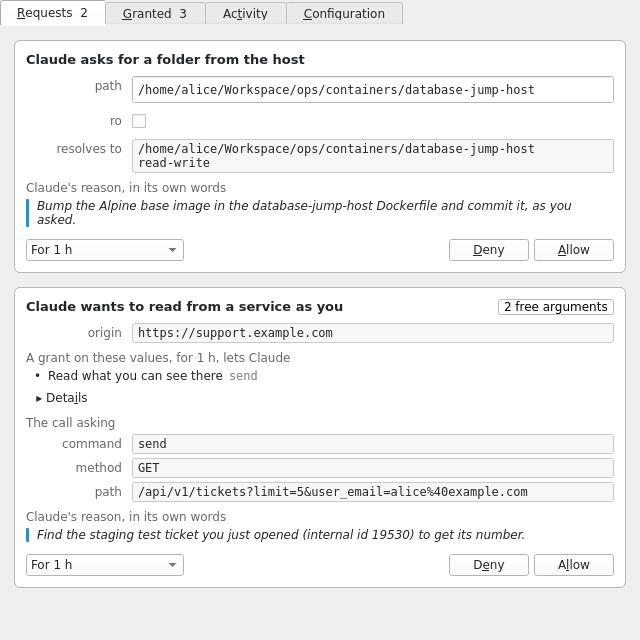
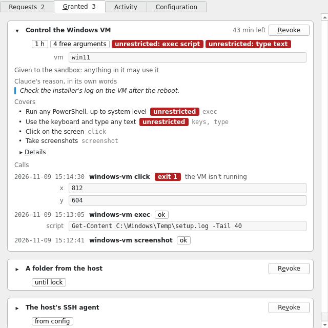

# agent-sandbox

An agent with a shell runs as you. It can read `~/.ssh`, every repo you have
checked out, and the browser profile, and it can reach whatever your machine
can: the VPN mesh, the auth proxy on `127.0.0.1`, the cluster API behind them.
One prompt injection in a README it was asked to summarise is enough to use
all of that.

agent-sandbox runs Claude Desktop (with its Code tab) in a bubblewrap sandbox
on NixOS, built with [nixpak](https://github.com/nixpak/nixpak). It sees only
the paths you bind into it. It gets its own network namespace, joined to the
host by a netkit pair whose eBPF programs let it out only through the
physical uplinks (Ethernet and Wi-Fi, IPv4 and IPv6, NATed by
[einat](https://github.com/EHfive/einat-ebpf)), so it reaches the internet
but none of the services on the host, VPN routes, container bridges or other
sandboxes, whatever the host firewall says. It has its own single-user Nix
store, so `nix shell` and `nix build` work without the daemon of the host. The
privileged parts are a small helper, `netns-netkit`, with `cap_net_admin`
and `cap_bpf` to create the pair and attach its programs, and two system
services: einat and `sandbox-uplink`, which keeps the programs around einat
on the uplinks.

The sandbox comes with a doc for the Claude running inside it,
`/etc/claude/environment.md`, which says what it can see and where its limits
are. Your own `CLAUDE.md` imports it.

How it fits together, namespace by namespace: the diagram at the top of
[`nix/home/claude-desktop/default.nix`](nix/home/claude-desktop/default.nix).
Working on the repo: [`CLAUDE.md`](CLAUDE.md).

## Usage

Import both modules and enable the Home Manager one per user:

```nix
{
  inputs.agent-sandbox.url = "github:orbit-online/agent-sandbox";

  # In the NixOS configuration
  imports = [ inputs.agent-sandbox.nixosModules.claude-desktop ];
  hardware.graphics.enable = true;
  home-manager.sharedModules = [ inputs.agent-sandbox.homeModules.claude-desktop ];
  home-manager.users.alice.agent-sandbox.claude-desktop = {
    enable = true;
    # Keyed by the path in the sandbox, `src` is the host path (default: the same)
    binds."/home/alice/src/project".rw = true;
  };
}
```

The NixOS module installs `netns-netkit` for group `users`, so the user has
to be in it, and needs Linux 6.8 or later. Then add `@/etc/claude/environment.md` to `~/.claude/CLAUDE.md`.

Other options: `extraPath` (directories ahead of the PATH packages),
`nameservers` (the DNS servers of the sandbox; empty follows the host's resolved or NetworkManager), `network.enable`
(off: a netns with `lo` alone, for local models), `environmentFile` (your own version of
[`environment.md`](nix/home/claude-desktop/environment.md)), `environmentText`
(appended to it), `env`, `path`, `kvm`, `devices`, `audio`, `tray`, `splash` (see Launching) and
`sandbox` (extra nixpak configuration). The descriptions are in the feature modules in
[`nix/home/claude-desktop/`](nix/home/claude-desktop/), the general ones in
[`options.nix`](nix/home/claude-desktop/options.nix).

## Launching

`claude-desktop` starts the sandbox as a user unit and shows a splash while it
gets ready: the step it's at, with a progress bar while it copies the
sandbox's programs into its store (the first launch after a rebuild), until
the app's first window is up. When the start fails, the splash shows why with
the app's last output; so it does when the app ends with an error later. After
10 seconds it offers Abort, which stops the start; so does Ctrl-C when you
started it from a terminal, which gets the same messages. The splash shows
the Orbit logo with the app's icon beside it, smaller: `splash.logo`,
`splash.logoDark` and `splash.agentLogo` take other files, `null` for none.

## memo

With [memo](https://github.com/secoya/agent-memos)'s Home Manager module,
`memo.enable` gives the sandbox memo with your stores and one of its own.
The sections of `environment.md` that only some work needs (the sandbox's
home, user namespaces, Nix) move into that store and load by topic, and
`/etc/claude/environment.md` keeps the rest. The module adds the store to
`programs.agent-memos.settings.stores` by its store path, right after the
embedded stores, and the sandbox mounts the same `config.yaml`: `memo` on the
host shows what Claude inside gets.

## MCP servers

The app gets the sandbox's own two (`filesystem` for the binds with `mcp`, and
`claude-code`) and Home Manager's
[`programs.mcp.servers`](https://nix-community.github.io/home-manager/options.xhtml#opt-programs.mcp.servers)
when `programs.mcp.enable` is on, in every launcher. They run inside the
sandbox, so what a server needs from the host (a socket directory, its config
file) goes in `binds` or `files`. Only local servers (`command`) work.

## Shell in the sandbox

The app's launcher entry gets a "New shell" action, which runs
`claude-desktop --shell` in your terminal through
[`xdg-terminal-exec`](https://gitlab.freedesktop.org/terminal-wg/specifications)
(pick the terminal in `xdg-terminals.list`). It's a login shell where the app
runs, with the environment its Code tab gets. If the app isn't running, it
starts it first.

## Permissions

With `permissions.enable`, a launcher runs a broker on the host that grants
the sandbox more while it runs: a folder (`permissions.folders`), a host
socket at a stable address (`permissions.sockets`) or declared commands run on
the host (`permissions.commands`). Claude asks through the sandbox's
`permissions` MCP server, you answer in a notification and pick how long the
grant lasts, and the Permissions window (the launcher's "Permissions" action,
or Options on the notification) shows what's waiting, what's granted and what
Claude did with it:





The design: [`docs/permissions.md`](docs/permissions.md).

### request-send

Lets Claude make HTTP requests as you to services that take Orbit's users CA client certificates over the mesh, such
as the osTicket helpdesk's `/api/orbit/v1` on its staff vhost (support.orbit.online's `mcp/` server is the client).
The sandbox can't reach the mesh; the host sends. It declares two host command capabilities, each bounded by the
service (`origin`) and with one command, `send`:

- `request-send` sends GET requests, for reading.
- `request-send-write` sends GET and POST requests, for writing: what a POST does there is done as you.

Each call runs `request-send send` on the host with the call on stdin: the method, the path and query, and for a
write the body, sent as `application/json`. Each origin has its `env` and `ca`: after checking that
`~/.step/certs/cloud-<env>.crt` is the certificate of the TPM key `tpmkms:name=cloud-<env>` and valid now, it connects
to the origin over TLS 1.3, trusting only the CAs in its `ca`, presents the certificate and has `step kms sign`
(step-kms-plugin) sign the handshake. It follows no redirects and prints `{"status", "content_type", "body"}`,
refused when the answer is over 8 MiB or not UTF-8. The call only names the request; the command fixes the origin to
one of the module's, the headers and the TLS. The key never leaves the TPM and the sandbox never sees it, nor
anything it could send on its own.

```nix
agent-sandbox.claude-desktop.permissions = {
  enable = true;
  request-send = {
    enable = true;
    # Each env's staff vhost, with that env's users CA certificate (cloud-<env>) and the machines CA its
    # certificate is from (nixos-workstation's orbit-cas package)
    origins = {
      "https://support-staff.org-production.orbit.dev" = { env = "production"; ca = orbit-cas.production.machines_ca; };
      "https://support-staff.org-staging.orbit.dev" = { env = "staging"; ca = orbit-cas.staging.machines_ca; };
    };
  };
  # Reads without asking; writes still ask, once or for a lease
  grants = [ { capability = "request-send"; params.origin = "https://support-staff.org-production.orbit.dev"; } ];
};
```

Without a grant in `permissions.grants`, reads ask like writes do. The module adds none: a standing grant is yours to
declare. A call that asks shows its arguments in the Permissions window (Options on the notification), a write's body
whole; allow it once to see each request before it's sent, or for a time to let Claude work on its own.

The calls run as you on the host and use the TPM, so you need the TPM's device (on NixOS
`security.tpm2.enable = true` and your user in `tss`), the certificate from `step` as you have it for the users CA,
and the mesh. The default `step` is nixpkgs' step-cli with step-kms-plugin on its PATH; `step` takes another.

## State and maintenance

Everything the sandbox keeps lives in `~/.local/share/claude-desktop` on the
host: `home/` (the sandbox's `$HOME`), `nix/` (its store, at `/nix`) and
`tmp-scratchpad/` (Claude Code's temp dir with the session scratchpads, at
`/tmp/claude-<uid>`, so they survive restarts). The rest of `/tmp` is a
tmpfs.

The sandbox's store paths are bound from the host's store, so the launcher
roots them there too, at `$XDG_RUNTIME_DIR/claude-desktop/store-roots`: a GC
after a rebuild leaves a running sandbox alone. The next launch replaces the
root and logging out removes it.

A `systemd --user` in the sandbox keeps it in check with two timers, each
caught up at the next start when the sandbox wasn't running:

- `claude-desktop-store-gc` collects the sandbox's store after the launcher
  has moved its GC root (on every rebuild that changes the sandbox), and
  otherwise once a week. It refuses to run outside the sandbox.
- `claude-desktop-scratchpad-prune` removes session scratchpads with nothing
  changed in 30 days.

Each launcher logs to two journald namespaces:
`journalctl --namespace=claude-desktop[-<name>]` for the launcher, the
permissions broker, subid-broker and the D-Bus proxy (its refusals:
`-t dbus-proxy -p warning`), and `--namespace=claude-desktop[-<name>]_sandbox`
for the app's output and what runs in the sandbox. The sandbox reads both and
writes only to its own.
